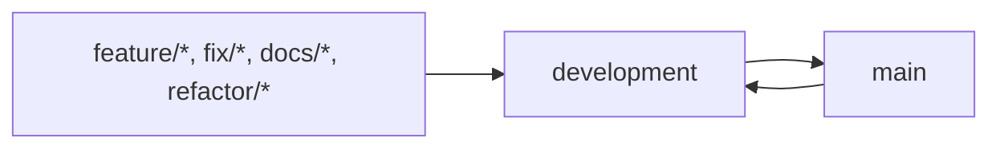

# Contributing to ananke

Thanks for helping improve Ananke. This document describes the current contribution workflow for this repository.

* [Ways to contribute](#ways-to-contribute)
* [Release process](#release-process)
* [Before you start](#before-you-start)
* [Reporting bugs and requesting features](#reporting-bugs-and-requesting-features)
* [Branch strategy](#branch-strategy)
  * [Long-lived branches](#long-lived-branches)
  * [Branch naming](#branch-naming)
* [Pull request workflow](#pull-request-workflow)
* [Circumventing git hooks](#circumventing-git-hooks)
* [Documentation contributions](#documentation-contributions)
* [Attribution](#attribution)
* [License](#license)

## Ways to contribute

* Report bugs
* Suggest enhancements
* Improve documentation
* Improve templates, styles, or assets
* Improve translations in `i18n/*.toml`

## Release process

The project follows a structured release workflow based on conventional commits, staging branches, and automated versioning.

For details, see [Branch Strategy](#branch-strategy).

## Before you start

1. Use a compatible Hugo version (see [`config/_default/module.toml`](https://github.com/gohugo-ananke/ananke/blob/main/config/_default/module.toml) for the current state).
2. Install dependencies:

```bash
npm install
```

1. Run a local preview via `npm run` instead of just calling `hugo server`:

```bash
npm run server
```

 This runs the documentation site from `site/` using contents from `docs/` with local configuration.

1. Follow the coding style and format commit messages as described in the conventional commits specification (for example: `docs: add troubleshooting section` or `fix: correct hero image path`).

2. Make sure to install git hooks for linting and testing before you push changes:

```bash
npm run prepare
```

 This command is run automatically after `npm install` but you can run it manually to set up hooks in an existing clone or update changed hooks. It uses `simple-git-hooks` to install a commit hook that runs `lint-staged` for markdown files, which in turn runs linting tasks on staged files.

## Reporting bugs and requesting features

* Open bugs in [GitHub Issues](https://github.com/gohugo-ananke/ananke/issues).
* Start feature or idea discussions in [GitHub Discussions](https://github.com/gohugo-ananke/ananke/discussions).
* Include clear reproduction steps, expected behaviour, actual behaviour, and versions (`hugo version`, OS, browser if relevant).

## Branch strategy



This repository uses a linear, rebase-based branch model. Long-lived branches MUST stay connected to `main`, and merge commits MUST NOT be introduced.

### Long-lived branches

| Branch | Purpose | Release role | Write policy | Merge |
| --- | --- | --- | --- | --- |
| `main` | Stable source of truth | releases | Protected. Only receives reviewed PRs from `development`. | Rebase |
| `development` | Active development | pre-releases | Feature, fix, chore, and documentation PRs target this branch. | Squash |

### Branch naming

Use short-lived branches for regular work:

* `feat/<topic>`
* `fix/<topic>`
* `docs/<topic>`
* `chore/<topic>`
* `refactor/<topic>`

After a successful rebase between those branches, push with lease:

```bash
git push --force-with-lease
```

## Pull request workflow

1. Fork the repository and create a focused branch.
2. Keep the change set small and cohesive (which means, DO NOT introduce multiple changes in a single PR).
3. Update docs for all user-facing changes.
4. Run quality checks locally:

```bash
npm run lint:markdown
```

1. If your change affects behaviour, validate with Hugo locally (for example `hugo` or `hugo server` in the relevant project).
2. Open a pull request with:

* a clear summary,
* motivation/context,
* screenshots when UI/visual output changes,
* linked issues (for example: `Fixes #123`).

## Circumventing git hooks

To prevent `git commit` and `git push` from running hooks you can use the `--no-verify` flag:

```bash
git commit --no-verify -m "docs: update README"
git push --no-verify origin my-feature-branch
```

This should be used sparingly and only when you have a good reason to bypass checks. If you find yourself needing to use `--no-verify` frequently, please consider improving the hooks or contributing fixes to reduce false positives.

## Documentation contributions

The theme documentation lives in a separate repository at [gohugo-ananke/documentation](https://github.com/gohugo-ananke/documentation).

Please keep links relative where possible and remove stale references when updating pages.

## Attribution

If you want to receive attribution for your contribution please follow the [contribution guidelines](https://allcontributors.org/en/bot/usage/) to add yourself to the list of contributors [in the Ananke theme documentation](https://github.com/gohugo-ananke/documentation/). A permanently open issue to add your contribution can be found [at the documentation repository](https://github.com/gohugo-ananke/documentation/issues/1). Read the initial message to understand how to add yourself to the list of contributors.

## License

By contributing, you agree that your contributions are provided under the repository license in [LICENSE.md](LICENSE.md).
